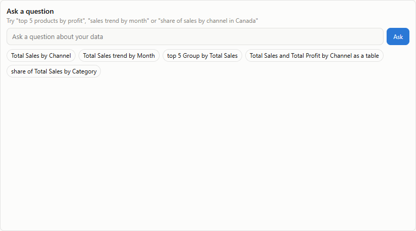
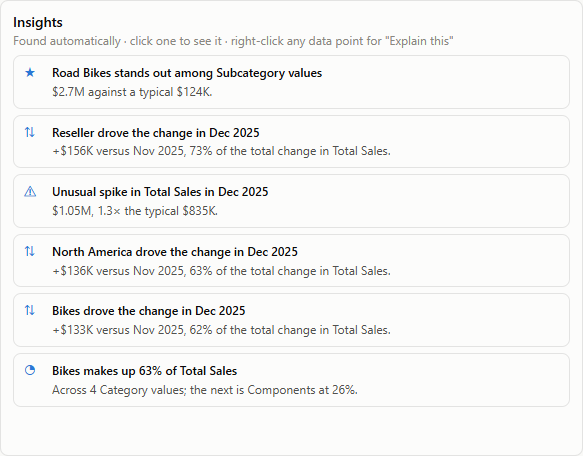
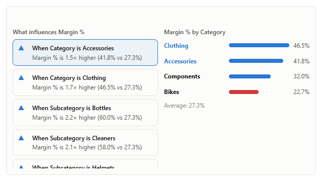
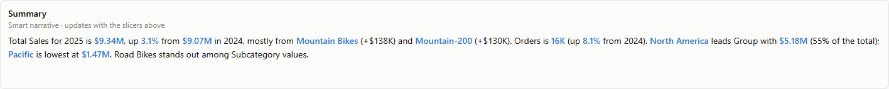
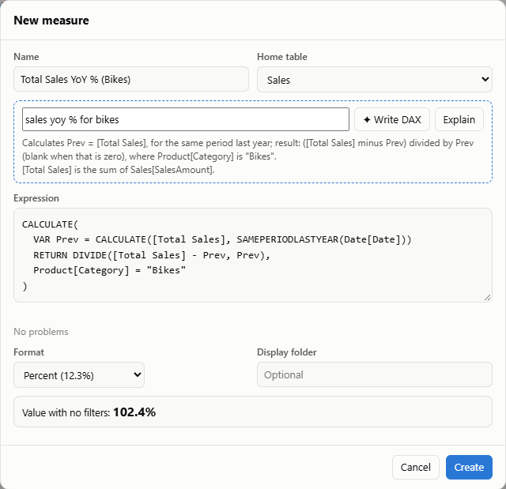
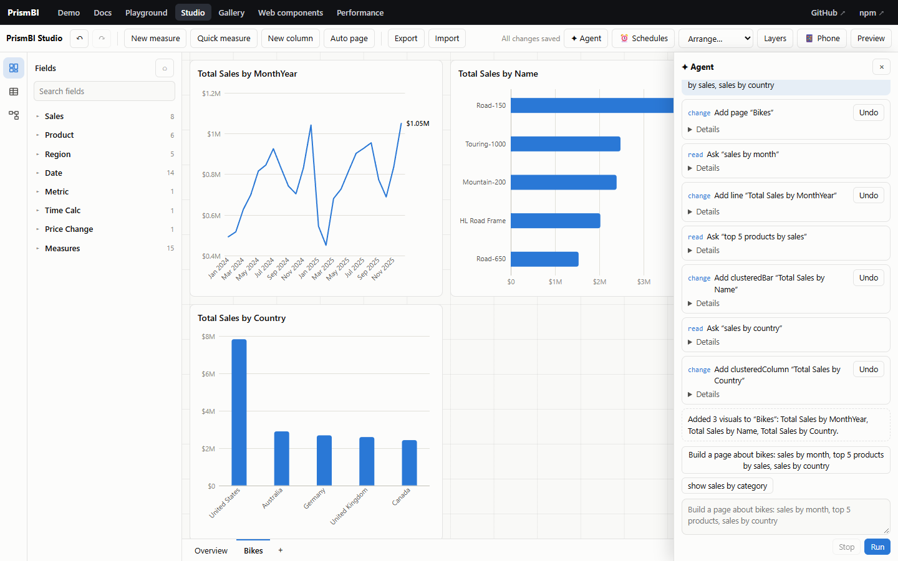

# AI: questions, explanations, insights and agents

`@prismbi/prismbi/ai` adds four things. Everything runs offline on the model by default, with no API keys or network calls:

- **Ask:** a plain-language question becomes a visual.
- **Explain:** why a value is what it is.
- **Insights:** what's unusual in the data.
- **Agents:** context and tools for AI agent frameworks.

Language models are optional, plugged in through a function you provide.

```ts
import '@prismbi/prismbi/ai'; // registers the `qna` and `insights` visuals and "Explain this" on right-click
import { ask, explain, findInsights, getAIContext, createAgentTools } from '@prismbi/prismbi/ai';
```

## Ask

```ts
const { spec, interpretation, unmatched, confidence } = askSync(model, 'top 5 products by profit in 2025');
// spec → { type: 'clusteredBar', fields: { category: 'Product[Name]', values: ['Total Profit'] }, top: 5, sort: …, filters: [Year = 2025] }
report.addVisual({ ...spec, layout: { x: 0, y: 0, w: 6, h: 7 } });
```

The parser builds its vocabulary from the model: measure names (with "Total Sales" also answering to "sales"), table and column names, and the values of short text columns. It understands:

| You say | It does |
|---|---|
| `by category`, `per region`, `for each channel` | groups by the column (a table name picks its label column) |
| `in Canada`, `bikes and clothing` | filters on the column holding those values |
| `2025`, `last year`, `this year`, `last quarter`, `last 6 months`, `ytd` | date filters relative to the latest date with data |
| `top 5`, `bottom 3`, `highest`, `lowest` | Top N and sort direction |
| `average price`, `max quantity`, `how many orders`, `distinct customers` | implicit aggregations |
| `trend`, `share`, `as a table`, `matrix`, `scatter`, `as bars` | the visual type |

Without a hint it picks a sensible chart:

| Question shape | Chart |
|---|---|
| No grouping | A card |
| Grouped by time | A line, by year-month unless a single year is selected |
| Few categories | Columns |
| Many categories or a Top N | Bars |
| Two groupings | A clustered or matrix layout |

`unmatched` lists words it didn't understand. `confidence` is the share of the question it did.

- **Synonyms:** `askSync(model, q, { synonyms: { 'Total Sales': ['revenue', 'turnover'] } })`.
- **Language model:** `await ask(model, q, { llm })` calls `llm(prompt)` with the schema and the question. It expects a JSON plan back. Plans that reference unknown fields fall back to the rules (`source` says which was used). `llmPrompt(model, q)` shows the exact prompt.

```ts
const llm = async (prompt: string) => (await fetch('/api/llm', { method: 'POST', body: prompt })).text();
const answer = await ask(model, 'how did margins move in Europe vs last year?', { llm });
```

### The Q&A visual



```ts
{ type: 'qna', title: 'Ask a question', layout: { x: 0, y: 0, w: 7, h: 9 }, fields: {},
  format: { qna: { synonyms: { 'Total Sales': ['revenue'] }, suggestions: ['sales by month'] } } }
```

- **Answers:** a nested visual, filtered by the page's slicers and filters.
- **Chips:** show how the question was understood.
- **Empty box:** suggested questions generated from the model.

## Explain

```ts
const x = explain(model, { measure: 'Total Sales', filters: [{ target: 'Date[Year]', op: 'eq', value: 2025 }] });
x.summary; // "Total Sales rose 3.1% to $9.34M from $9.07M in 2024. Biggest contributors: Category Bikes (+$138K, …)"
x.drivers; // [{ column: 'Product[Category]', value: 'Bikes', current, baseline, delta, share }, …]
```

- **Change mode:** when the filters contain a period (a year, a date range, a day), the value is compared with the period before. Members of each dimension are ranked by their contribution to the change.
- **Composition mode:** otherwise, it says which members make up the value.
- **Dimensions:** text columns of tables wired into the model. Calculation groups and parameter tables are skipped. Pass `dimensions` to choose them.

Right-clicking any data point offers **Explain this** once `@prismbi/prismbi/ai` is imported (`enableExplain(false)` turns it off). Its panel shows the summary, the top drivers and a chart.

## Insights



```ts
findInsights(model, { measure: 'Total Sales', filters, max: 6 });
// [{ kind: 'outlier', title: 'Road Bikes stands out among Subcategory values', detail: '$2.7M against a typical $124K.', score, spec }, …]
```

| Kind | Finds |
|---|---|
| `anomaly` | periods far from a rolling median (robust z-score ≥ 3.5) |
| `trend` | the latest periods against the ones before (±5% or more) |
| `mover` | the member that drove most of the change in the latest period |
| `concentration` | one member holding 40% or more of the total |
| `outlier` | members far from the rest of their dimension |

The `insights` visual (`fields: { values: 'Total Sales' }`, optional `dimensions`) lists them for the current filters. Clicking one shows its chart.

### Anomaly alerts

`watchAnomalies` re-runs the insights whenever the model changes (streams, refreshes, appended rows) and reports each new finding once:

```ts
const stop = watchAnomalies(model, {
  measure: 'Total Sales',
  filters: [{ target: 'Region[Country]', op: 'eq', value: 'Canada' }],
  kinds: ['anomaly', 'mover'],      // default ['anomaly']: unusual spikes and dips
  debounceMs: 500,
  onAnomaly: ({ insight }) => notify(`${insight.title}: ${insight.detail}`),
});
```

What is already unusual when watching starts doesn't alert, unless you set `alertExisting: true`. In a report definition, use `alerts: [{ …, when: { anomaly: true } }]`. The server's `watchAlerts` runs those too (see [Server](server.md)).

## Key influencers

`keyInfluencers(model, { measure, explainBy?, filters?, basis?, minShare?, max? })` finds the column values that move a measure most: every value of every column is compared with the overall figure, and large effects in large segments come first.



```ts
keyInfluencers(model, { measure: 'Margin %', explainBy: ['Product[Category]', 'Region[Group]'] });
// { metric: 'Margin %', overall: 0.273, influencers: [{ label: 'Category is Accessories', effect: '1.5× higher', segment: 0.418, share: 0.37, … }, …], columns: [...] }
```

- **Sums and counts** are compared per row (`basis: 'perRow'`, chosen automatically when the measure adds up over a column's segments): "Total Sales per row is 78% lower when Category is Accessories". Averages and rates (`basis: 'value'`) are compared as they are.
- **Columns:** `explainBy` defaults to the model's categorical columns, as for insights. Segments under `minShare` of the rows (default 5%) are ignored, and the same rows reached through two columns (a subcategory with a single product) are listed once.
- **The visual:** `type: 'keyInfluencers'` (`fields: { values: 'Margin %', explainBy: [...] }`, alias `influencers`) lists the influencers on the left and the chosen one's column against the average on the right. Clicking a bar cross-filters the page. `format.keyInfluencers` takes `max`, `minShare` and `basis`. Register it with `registerAI()`.

## Narrative

The `narrative` visual writes a short summary of its measures that updates with filters and selections, like Power BI's smart narrative:



```ts
{ type: 'narrative', fields: { values: ['Total Sales', 'Orders'], category: 'Region[Group]' }, format: { narrative: { insights: 1 } } }
// "Total Sales for 2025 is $9.34M, up 3.1% from $9.07M in 2024, mostly from Mountain Bikes (+$138K) and Mountain-200 (+$130K).
//  Orders is 16K (up 8.1% from 2024). North America leads Group with $5.18M (55% of the total); Pacific is lowest at $1.47M. …"
```

- **What it covers:**
  - The first measure gets its value, the change from the previous period (when the filters name a year or date range) and the biggest contributors.
  - Other measures (up to three) get their value and change.
  - The optional `category` adds a breakdown: the leader and the lowest, or the trend for dates and numbers.
  - `format.narrative.insights` (default 2) appends the top `findInsights` results.
- **Custom text:** `format.narrative.text` sets the wording, e.g. `'Revenue is {[Total Sales]} across {[Orders]} orders.

{summary}'`. `{[Measure]}` becomes a formatted value, `{summary}` the automatic text, and a blank line starts a paragraph.
- **Rewording with a language model:** `setNarrativeWriter(async (facts) => callYourLLM(facts))`. The rule-based text shows immediately, and the reworded version replaces it when it arrives. Results are cached per filter state. Set `format.narrative.llm: false` to keep a visual rule-based.
- **Outside a visual:** `writeNarrative(model, { measures, filters, breakdown?, insights?, template? })` returns `{ text, sentences }`. Each sentence is a list of parts, with `{ value }` parts for the emphasised numbers and names.

## DAX copilot

Write measures from plain English, and explain existing ones:



```ts
import { writeDax, writeDaxSync, explainDax, daxCopilot } from '@prismbi/prismbi/ai';

writeDaxSync(model, 'sales year to date');
// { expression: 'TOTALYTD([Total Sales], Date[Date])', name: 'Total Sales YTD', value: …, note: 'Understood: …', source: 'rules' }
writeDaxSync(model, 'sales yoy % for bikes');   // VAR Prev = … RETURN DIVIDE(…) inside CALCULATE(…, Product[Category] = "Bikes"), format 0.0%
writeDaxSync(model, 'profit per order');        // DIVIDE([Total Profit], [Orders])
explainDax(model, 'CALCULATE([Orders], ALL(Product), Product[Color] = "Red")');
// "Calculates [Orders], ignoring filters on Product and where Product[Color] is "Red".
[Orders] is the number of distinct Sales[OrderNumber]."
```

- **What the rules understand:**
  - The model's measures, numeric columns with an aggregation ("average quantity"), and values as filters ("for bikes in 2025").
  - Ratios: "X per Y", "X divided by Y", "X margin".
  - Time intelligence: YTD, QTD, MTD, last year, year-over-year change and %, running total, and share of total.
- **Validation:** every suggestion is checked by evaluating it, so a broken expression never comes back.
- **With a language model:** `writeDax(model, text, { llm })` asks the model for JSON (`daxPrompt` builds the prompt from the model context). It validates the answer and retries once with the error. If both attempts fail, it falls back to the rules, and the `note` says why.
- **In the Studio:** pass `copilot: daxCopilot(model, { llm? })` to `new Studio(…)`, or call `studio.setCopilot(…)`.
  - The measure editor gains a "Describe it" box with **✦ Write DAX** and **Explain**.
  - The suggestion fills in the expression, name and format.
  - The usual live preview and checks run before saving.

## Agents

Agent frameworks need two things: context about the data, and tools to act on it.

### Context

```ts
const ctx = getAIContext(model, { report });   // serialisable JSON
const system = contextToPrompt(ctx);           // compact text for a system prompt
```

The context contains:
- **Tables:** row counts and columns, each with type, distinct count, examples or min/max, format and calculated-column DAX.
- **Model:** relationships, and measures with their DAX, format and description.
- **Report state** (with a `report`): current page, pages, the visuals on the page with their fields, report and page filters, slicer selections and the cross-filter selection.

### Tools

`createAgentTools({ model, report })` returns provider-agnostic tools, each with a JSON-schema input and a `run` function:

| Tool | Does |
|---|---|
| `describe_model` | schema, relationships, measures |
| `list_values` | distinct values of a column (with search), to find exact filter values |
| `run_query` | group, aggregate, sort, Top N; formatted and raw values plus totals |
| `evaluate_dax` | a scalar expression, or `EVALUATE <table expression>` |
| `ask` | a question → a visual spec |
| `explain_value`, `find_insights` | as above |
| `get_report_state`, `go_to_page` | with a report |
| `add_page`, `add_visual`, `remove_visual`, `set_filters` | with a report and writes allowed |
| `create_measure` | validated by evaluating it first; writes allowed |

- **Writes:** allowed by default when a report is attached. Set `allowWrites: false` for read-only agents.
- **Dates:** may arrive as ISO strings and are revived automatically.
- **Errors:** `runTool` returns them as `{ error }` so the agent can correct itself.
- **Formats:** convert the tools with `toAnthropicTools`, `toOpenAITools` or `toMcpTools`.

### A Claude agent loop

Run this on your server with the Anthropic SDK:

```ts
import Anthropic from '@anthropic-ai/sdk';
import { createAgentTools, getAIContext, contextToPrompt, runTool, toAnthropicTools } from '@prismbi/prismbi/ai';

const client = new Anthropic();
const tools = createAgentTools({ model, report });
const messages: Anthropic.MessageParam[] = [{ role: 'user', content: 'Build a page explaining why 2025 sales grew, by region and product.' }];

for (;;) {
  const res = await client.messages.create({
    model: 'claude-opus-5-5',
    max_tokens: 4096,
    system: `You are a BI analyst working in a PrismBI report.\n\n${contextToPrompt(getAIContext(model, { report }))}`,
    tools: toAnthropicTools(tools),
    messages,
  });
  messages.push({ role: 'assistant', content: res.content });
  if (res.stop_reason !== 'tool_use') break;
  const results = await Promise.all(
    res.content.filter((b) => b.type === 'tool_use').map(async (b) => ({
      type: 'tool_result' as const,
      tool_use_id: b.id,
      content: JSON.stringify(await runTool(tools, b.name, b.input)),
    })),
  );
  messages.push({ role: 'user', content: results });
}
```

The same tools work with any orchestrator that accepts JSON-schema tools: OpenAI function calling, LangGraph, the Vercel AI SDK, and your own planner.

### `runAgent` and LLM adapters

`runAgent` is the same loop without an SDK. It works with any model through a small adapter:

```ts
import { runAgent, anthropicLLM, openAILLM, createAgentTools } from '@prismbi/prismbi/ai';

const result = await runAgent({
  llm: anthropicLLM({ url: '/api/llm' }),        // or openAILLM({ url, model }) for OpenAI-compatible servers (Azure, Ollama, vLLM…)
  tools: createAgentTools({ model, report }),
  prompt: 'Build a page explaining Q3 by region and product',
  beforeTool: (call, write) => !write || confirm(`Run ${call.name}?`),
  onStep: (step) => console.log(step.call.name, step.result),
});
console.log(result.text);
```

- **Keys stay on your server.** Point `url` at a proxy that adds the API key. `apiKey` also works for local experiments; it sends the browser-access header Anthropic requires.
- **Your own model:** an `AgentLLM` is one function, `({ system, messages, tools, signal }) => { text?, toolCalls? }`. Messages use a neutral format (`user`, `assistant` with `toolCalls`, and `tool` results).
- **Offline:** `ruleBasedLLM()` needs no model. It splits the prompt into a page and questions with `planPrompt`, then calls `add_page`, `ask` and `add_visual`. It handles "build a page about X: A, B and C"-style requests; anything open-ended needs a real model.
- **Defaults:** `maxSteps` defaults to 16 model turns. `WRITE_TOOLS` lists the tools that change things. Errors come back to the model as `{ error }`.

### The Studio agent panel



```ts
import { agentPanel, anthropicLLM } from '@prismbi/prismbi/ai';

const agent = agentPanel(studio, {
  llm: anthropicLLM({ url: '/api/llm' }),  // omit to use the offline rule-based planner
  confirmWrites: false,                    // true: preview every change and wait for Apply / Skip
  suggestions: ['Build a page about bikes: sales by month, top 5 products, sales by country'],
});
```

- **Where it lives:** a **✦ Agent** button in the Studio top bar opens a side panel.
- **What it logs:** each tool call is listed with its input and result. Changes have an **Undo** button that restores the report from before that step and drops later steps. The model is told about the undo on its next turn.
- **Undo history:** every change is also a normal Studio undo step, so Ctrl+Z still works.
- **API:** `agent.run(prompt)`, `agent.undoStep(i)`, `agent.steps`, `open()`, `close()`, `destroy()`.

Try it with `npm run dev`, then open `/studio.html`. Add `?llm=/api/llm` to use your own Anthropic-compatible endpoint.

### Standalone MCP server

Expose a model to Model Context Protocol (MCP) clients (Cursor, Claude Desktop, Gemini, agents) with PrismBI's built-in zero-dependency server:

```ts
import { createMcpServer } from '@prismbi/prismbi/ai';

const mcp = createMcpServer({ model, allowWrites: false, name: 'sales-mcp' });

// Over stdio (standard input/output):
mcp.handleStdio();

// Or over any JSON-RPC 2.0 transport:
const response = await mcp.handleMessage(jsonRpcMessage);
```

You can also use the official `@modelcontextprotocol/sdk`:

```ts
import { Server } from '@modelcontextprotocol/sdk/server/index.js';
import { StdioServerTransport } from '@modelcontextprotocol/sdk/server/stdio.js';
import { ListToolsRequestSchema, CallToolRequestSchema } from '@modelcontextprotocol/sdk/types.js';
import { createAgentTools, runTool, toMcpTools } from '@prismbi/prismbi/ai';

const tools = createAgentTools({ model, allowWrites: false });
const server = new Server({ name: '@prismbi/prismbi', version: '0.11.0' }, { capabilities: { tools: {} } });
server.setRequestHandler(ListToolsRequestSchema, async () => ({ tools: toMcpTools(tools) }));
server.setRequestHandler(CallToolRequestSchema, async (req) => ({
  content: [{ type: 'text', text: JSON.stringify(await runTool(tools, req.params.name, req.params.arguments)) }],
}));
await server.connect(new StdioServerTransport());
```

The model engine has no DOM dependency, so this runs on Node. Load data with `@prismbi/prismbi/connectors`.

## Try it

```js playground
import { askSync, writeDaxSync, explainDax } from '@prismbi/prismbi/ai';
import { createVisual } from '@prismbi/prismbi';

const answer = askSync(model, 'top 5 products by sales in 2025');
const measure = writeDaxSync(model, 'sales year to date for bikes');
console.log(measure.expression, explainDax(model, measure.expression));
return createVisual(el, { model, ...answer.spec });
```

On the docs site (`npm run docs`), **▶ Run in playground** opens it in an editor next to its output.
