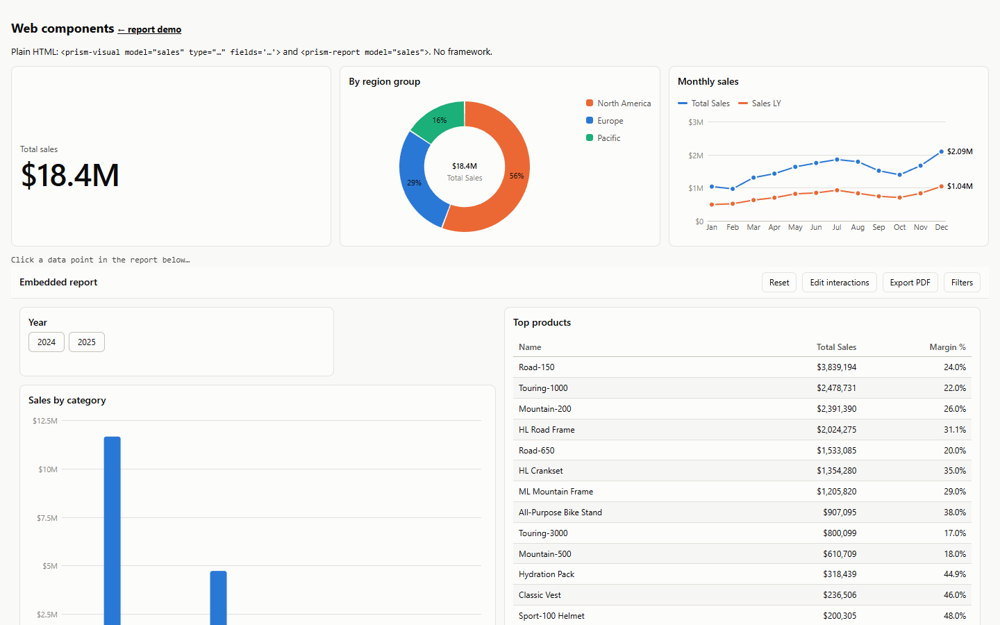

# Web components, Vue, Svelte and Angular

`@prismbi/prismbi/elements` defines two custom elements when imported: `<prism-report>` and `<prism-visual>`. Frameworks set DOM properties and listen to DOM events natively, so the same elements work in plain HTML, Vue, Svelte, Angular, Solid and Lit. React users can also use [`@prismbi/prismbi/react`](react.md).

Elements render into the light DOM, so the report stylesheet and your CSS variables apply as usual. Give them a height.

## `<prism-report>`

| Property | Attribute | Description |
|---|---|---|
| `model` | `model="name"` | The `DataModel`. The attribute names a model registered with `registerModel(name, model)`, which is handy in plain HTML. |
| `definition` | `src="/report.json"` | The report definition (object or JSON). `src` fetches it. Setting a new definition reloads the same report. |
| `theme` | `theme="dark"` | Theme name or object. Changing it re-themes without rebuilding. |
| `filters` | — | Controlled report-level filters. |
| `chrome` | — | Toolbar, page tabs, filter pane. |
| — | `locale`, `page` | Number and date locale; current page (id or name). |
| `report` (read-only) | — | The underlying `Report`, for the imperative API. |

Report events are re-dispatched as DOM events with the same name and the payload in `detail`: `selectionChanged`, `filtersChanged`, `pageChanged`, `dataPointClick`, `drill`, `rendered` and `error`.

## `<prism-visual>`

One visual for your own layout:
- **Properties:** `model` and `spec` (`{ type, fields, format, filters, … }`).
- **Attributes:** `type`, `fields` and `format` (both as JSON), `title`, `model`, `theme` and `locale`.

## Plain HTML



```html
<prism-visual model="sales" type="card" fields='{"value":"Total Sales"}' style="height: 200px"></prism-visual>
<prism-report model="sales" src="/reports/sales.json" style="height: 720px"></prism-report>

<script type="module">
  import { registerModel } from '@prismbi/prismbi/elements';
  registerModel('sales', buildModel()); // every element naming "sales" mounts now
</script>
```

Try it with `npm run dev`, then open `/elements.html`.

## Vue 3

Tell the compiler that `prism-*` tags are custom elements:

```ts
// vite.config.ts
vue({ template: { compilerOptions: { isCustomElement: (tag) => tag.startsWith('prism-') } } });
```

```vue
<script setup lang="ts">
import '@prismbi/prismbi/elements';
const model = buildModel();
const definition = { pages: [/* … */] };
</script>

<template>
  <prism-report :model="model" :definition="definition" theme="dark" style="height: 720px"
    @selectionChanged="(e) => console.log(e.detail.filters)" />
</template>
```

Vue passes objects to custom elements as properties automatically. Use `.prop` if you need to force it.

## Svelte

```svelte
<script>
  import '@prismbi/prismbi/elements';
  import { prismReport } from '@prismbi/prismbi/elements';
  const model = buildModel();
</script>

<prism-report {model} definition={report} on:dataPointClick={(e) => console.log(e.detail)} style="height: 720px" />

<!-- or as an action on any element -->
<div use:prismReport={{ model, definition: report, theme: 'dark', on: { pageChanged: (e) => console.log(e) } }} style="height: 720px" />
```

`prismVisual` is the matching action for a single visual.

## Angular

```ts
@Component({
  selector: 'app-dashboard',
  standalone: true,
  schemas: [CUSTOM_ELEMENTS_SCHEMA],
  template: `<prism-report [model]="model" [definition]="definition" theme="light"
               (selectionChanged)="onSelect($event.detail)" style="display:block;height:720px"></prism-report>`,
})
export class DashboardComponent {
  model = buildModel();
  definition = salesReport;
}
// main.ts
import '@prismbi/prismbi/elements';
```

## Custom tag names

`defineElements({ report: 'acme-report', visual: 'acme-visual' })` registers the same elements under other names, if `prism-*` clashes with something else on the page.
