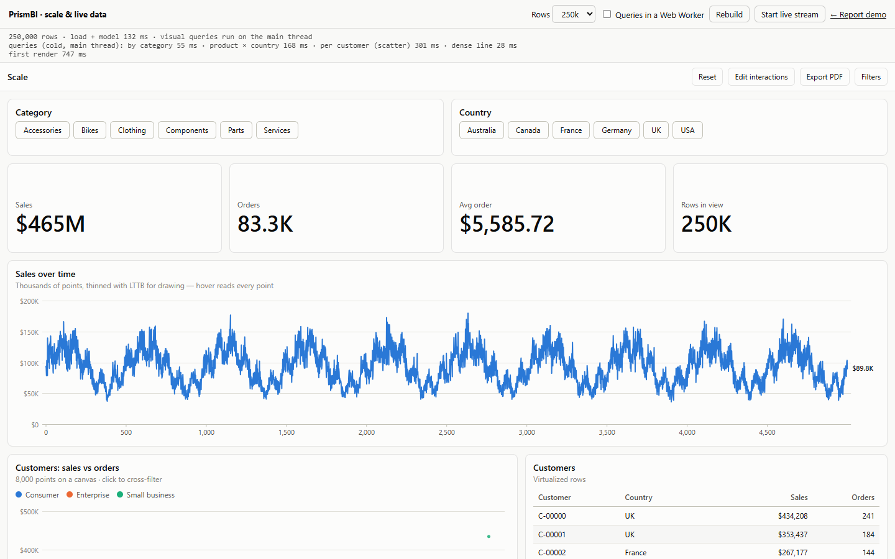

# Performance and scale

PrismBI keeps everything in the browser. This guide covers how the engine handles large tables, what to expect at a million rows, and how to move work off the main thread.

Try it with `npm run dev`, then open `/perf.html`. That page generates 100k to 1M rows, prints cold query timings, and runs a simulated live feed into the model.

## What the engine does for you

- **Columnar storage with typed views.** Each column is a plain array. On demand, the engine also builds a `Float64Array` view (numbers, dates as milliseconds) and a dictionary encoding (`Int32Array` codes + distinct values). Both are cached until the table changes.
- **Vectorised aggregations.** `SUM`, `AVERAGE`, `MIN`, `MAX`, `COUNT`, `COUNTA` and `DISTINCTCOUNT` over a column run as tight loops over those views.
- **Single-pass grouped queries.** A visual whose measures are built from those aggregations and `COUNTROWS` is answered in one pass over the fact rows. Measures may combine them with `+ - * /` and `DIVIDE`, and reference other such measures. This replaces evaluating every group separately. Group columns may be on the fact table or on dimensions reached through many-to-one relationships.
  - **Fallback:** anything else (time intelligence, `CALCULATE`, iterators, calculation groups in play, `USERELATIONSHIP`, `includeEmpty`) uses the general engine, so results never change.
  - **When it applies:** in `'auto'` mode it is used for multi-column groupings and for single columns with more than 1,000 values. Below that, indexed per-group evaluation is already faster.
  - **Toggle:** use `setFastQuery('always' | 'off' | 'auto')` to compare the two paths.
- **Per-dimension pre-aggregation.** Time intelligence and running totals evaluate the same measure once per day or period, each time with a different set of dates but otherwise identical filters. After a filter split repeats, the engine sums the fact column once per dimension row (per date, per product…). Each evaluation then adds up the visible rows' partials instead of scanning the fact table. This applies to `SUM`, `AVERAGE`, `MIN`, `MAX`, `COUNT` and `COUNTA` through a direct many-to-one relationship with no bidirectional filtering, and only when the dimension filters leave at least 16 rows visible.
- **Hash indexes and caches.** `eq`/`in` filters use column indexes. Visible row sets are cached per filter context and measure results per (measure, context). Visuals re-query only when their own filters change.

## Numbers

`npm run bench` generates a star schema and times each query cold, with caches cleared before each run. The schema is a fact table, 400 products, 40 regions and a two-year calendar. The query filters to one year, about half the rows. Timings are from Node 22 on a laptop:

| Query | 200k rows | 1M rows |
|---|---|---|
| Category × sales and average order value (12 groups) | 42 ms | 192 ms |
| Product × region, 16k groups | 57 ms (per-group engine: 10.1 s) | 156 ms |
| Day × sales, 365 groups | 8 ms | 11 ms |
| Day × YTD (time intelligence) | 121 ms (scan path: 0.65 s) | 193 ms (scan path: 2.8 s) |

Generating and loading 1M rows takes about 0.75 s. Warm queries (same filters again) come from the caches in well under a millisecond.

Pre-aggregated results can differ from a row-by-row scan in the last floating-point digits, because the same values are added in a different order. Displayed values are unaffected.

## Rendering at scale



- **Lines and areas** with more points than about two per pixel are thinned with Largest-Triangle-Three-Buckets for drawing. Peaks and gaps survive. The crosshair and tooltips still read every point. Stacked areas are drawn in full so the layers meet.
- **Scatter charts** with more than 3,000 points paint on a canvas laid over the SVG axes. A spatial grid finds the point under the pointer, so tooltips, click to select and cross-filter, the context menu and drill keep working. Without canvas support, for example in SSR or jsdom, they fall back to SVG.
- **Tables** with more than 500 rows render only the rows in view, plus a margin, between spacer rows. Sorting, selection and banding behave as before. `format.table.virtualize` forces windowing on or off, and wrapping text turns it off because rows then vary in height.

## Off the main thread

`@prismbi/prismbi/worker` (about 1.3 KB) runs the model in a Web Worker. Build or load the model inside the worker, then talk to it from the page:

```ts
// model.worker.ts
import { serveModel } from '@prismbi/prismbi/worker';
import { loadCsv } from '@prismbi/prismbi/connectors';
import { DataModel } from '@prismbi/prismbi/core';

const model = new DataModel().addTable('Sales', await loadCsv('/sales.csv')).addMeasure('Total', 'SUM(Sales[Amount])');
serveModel(model);
```

```ts
// main thread
import { createWorkerEngine } from '@prismbi/prismbi/worker';

const engine = createWorkerEngine(new Worker(new URL('./model.worker.ts', import.meta.url), { type: 'module' }));
const ctrl = new AbortController();
const result = await engine.query({ groupBy: ['Sales[Region]'], values: ['Total'] }, ctrl.signal);
```

The engine API is asynchronous, and every method returns a promise:

| Method | Does |
|---|---|
| `query(spec, signal?)` | Runs a `QuerySpec` and returns rows and totals. |
| `evaluate(expression, filters?, signal?)` | Evaluates a scalar expression. |
| `evaluateTable(expression, filters?, signal?)` | Evaluates a table expression (DAX `EVALUATE`). |
| `addTable(name, rows, schema?)`, `refreshTable(...)`, `appendRows(name, rows, options?)` | Changes table data. |
| `addMeasure(def)` | Adds a measure. |
| `setRoles(roles, options?)` | Switches row-level security roles. |
| `metadata()` | Returns tables, columns, measures and relationships, without rows. |
| `dispose()` | Stops the engine and terminates the worker. |

Filters must be filter specs (`{ target, op, value }`), because compiled filters can't be copied to another thread. Requests run in order. Aborting a request rejects it at once with an `AbortError`, and the worker skips it if it hasn't started.

`createLocalEngine(model)` has the same API on the current thread, for tests, server rendering or small models.

### Reports on the worker

Pass the engine to a report and every visual query runs in the worker:

```ts
const report = new Report(el, { model, engine, pages });
```

Visuals render asynchronously. On first load a visual shows a shimmer. After that, a re-query keeps the previous result on screen, dimmed, until the new one arrives, and superseded queries are cancelled.

Slicers and queries without measures still run on `model` on the page, so slicer tiles appear instantly. The page also uses `model` for metadata: field lists, slicer domains, colours.

Keep the two models in step. Build both from the same code, and apply live rows to both: `model.appendRows(...)` plus `engine.appendRows(...)`. The `/perf.html` demo has a "Queries in a Web Worker" switch that does exactly this.

## Tips

- Keep fact tables narrow and put descriptive text on dimensions. Group by dimension columns and let relationships do the work.
- Prefer measures built from the vectorised aggregations, such as `DIVIDE([Sales], [Orders])`, over `SUMX` row iterators when the result is the same.
- For live feeds, use `streamInto(…, { maxRows, intervalMs })`. The sliding window bounds memory, and batching bounds re-renders.
- Calculated columns that read only their own row are cheap to maintain under `appendRows`. Ones that aggregate are recomputed on every append.
