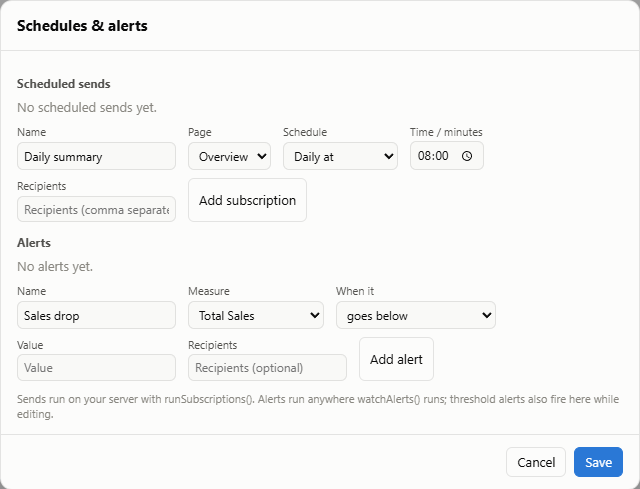

# Server: headless rendering, alerts and schedules

`@prismbi/prismbi/server` runs on Node (or any runtime) to render visuals and report pages without a browser, watch measures for alerts, and schedule report jobs. Rendering needs a DOM implementation you bring yourself, such as jsdom, linkedom or happy-dom. PrismBI itself adds no dependency.

```ts
import { JSDOM } from 'jsdom';
import { renderVisualSvg, renderReportHtml, watchMeasure, scheduleReport } from '@prismbi/prismbi/server';

const { window } = new JSDOM();
```

## Rendering

```ts
const svg = renderVisualSvg(model, { type: 'line', fields: { category: 'Date[MonthYear]', values: 'Total Sales' } }, { window, width: 640, height: 360 });
const html = renderReportHtml(model, reportDefinition, { window, page: 'Overview', width: 1280, theme: 'light' });
```

- **`renderVisualSvg`:** charts come out as their own vector `<svg>`. HTML visuals (cards, tables, slicers) are wrapped in a `foreignObject` together with the report styles. A visual that fails to render throws an error with its message.
- **`renderReportHtml`:** returns a self-contained HTML document with styles inlined and no scripts. Visuals are absolutely positioned from the page's grid layout at the width you pass. Use it for archives and HTML email bodies, or open it in any headless browser to produce PDF or PNG.
- **`withDom(window, fn)`:** installs the DOM globals for the duration of `fn`, then restores them. The renderers call it for you; use it directly to drive other PrismBI APIs headlessly.
- **`measure` report option:** the renderers size visuals with `ReportOptions.measure`, because a DOM without layout reports widths of 0. You can pass it to your own `Report` too.

## Alerts

```ts
const stop = watchMeasure(model, {
  measure: 'Total Sales',
  filters: [{ target: 'Region[Country]', op: 'eq', value: 'Canada' }],
  when: { below: 50_000 },          // or { above: n }, { changeBy: 0.1 } (10%), or (value, previous) => boolean
  onAlert: (e) => notify(`${e.measure} is ${e.value} (${e.condition})`),
  debounceMs: 500,                   // batch bursts of streamed rows
});
```

- **When it checks:** it re-evaluates whenever the model changes, so it reacts to `streamInto`, `scheduleRefresh` and `appendRows`.
- **Thresholds are edge-triggered:** one alert per crossing. A value that already starts past the threshold doesn't alert until it crosses again.
- **`changeBy`** compares against the value at the last alert.

## Schedules

```ts
scheduleReport({
  every: 'daily@08:00',             // or milliseconds
  run: async () => {
    const html = renderReportHtml(model, report, { window });
    await mailer.sendMail({ to: 'team@example.com', subject: 'Daily sales', html });
  },
  onError: console.error,
});
```

- **Overlapping runs are skipped.**
- **Delivery is yours:** use nodemailer, Slack webhooks, object storage, or anything else.
- **`msUntilDaily('08:00')`** tells you when the next daily run is due.

## Subscriptions and alerts from the report

Authors define scheduled sends and alerts in the Studio (**⏰ Schedules**), or in the report definition:



```ts
{ pages: [/* … */],
  subscriptions: [{ id: 's1', name: 'Daily summary', page: 'overview', schedule: 'daily@08:00', recipients: ['team@example.com'] }],
  alerts: [{ id: 'a1', name: 'Sales drop', measure: 'Total Sales', when: { below: 1_000_000 }, recipients: ['ops@example.com'] }] }
```

Run them on a server with your delivery code:

```ts
const stopSends = runSubscriptions(model, report, { window, send: (sub, html) => mailer.sendMail({ to: sub.recipients, subject: sub.name, html }) });
const stopAlerts = watchAlerts(model, report, (alert, e) => notifyChannel(alert.recipients, `${alert.name}: ${e.value}`));
```

- **Anomaly alerts:** `when: { anomaly: true }` (optional `kinds`) alerts on unusual spikes and dips found by the insights engine. The event carries `insight: { kind, title, detail }`, and `condition` is the insight's title. These run with `watchAlerts`. The Studio's live preview covers threshold alerts only.
- **Disabled entries:** `enabled: false` skips a subscription or alert.
- **Live data:** alerts re-evaluate on every model change.
- **Studio preview:** alerts fire as notifications while editing, so authors can check their thresholds.
