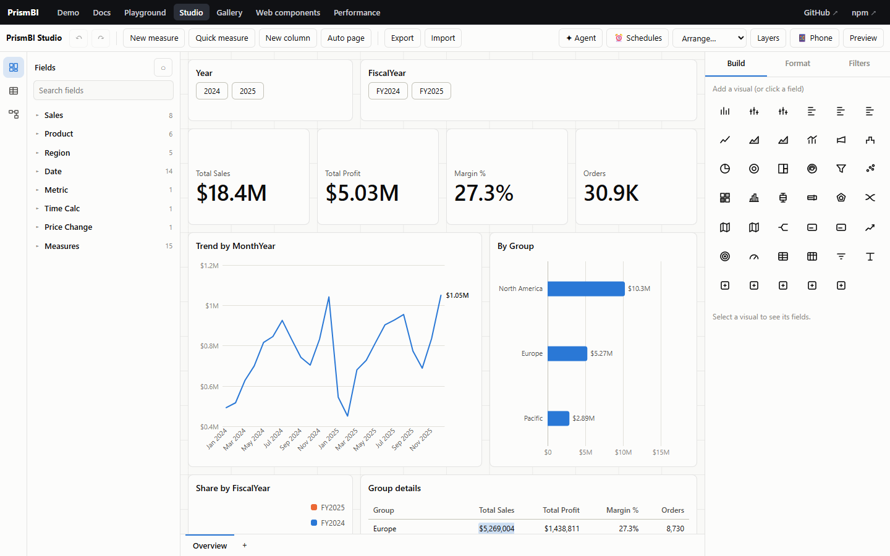
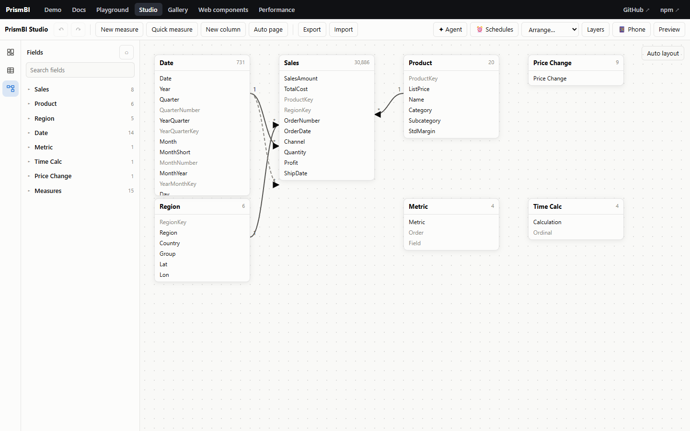
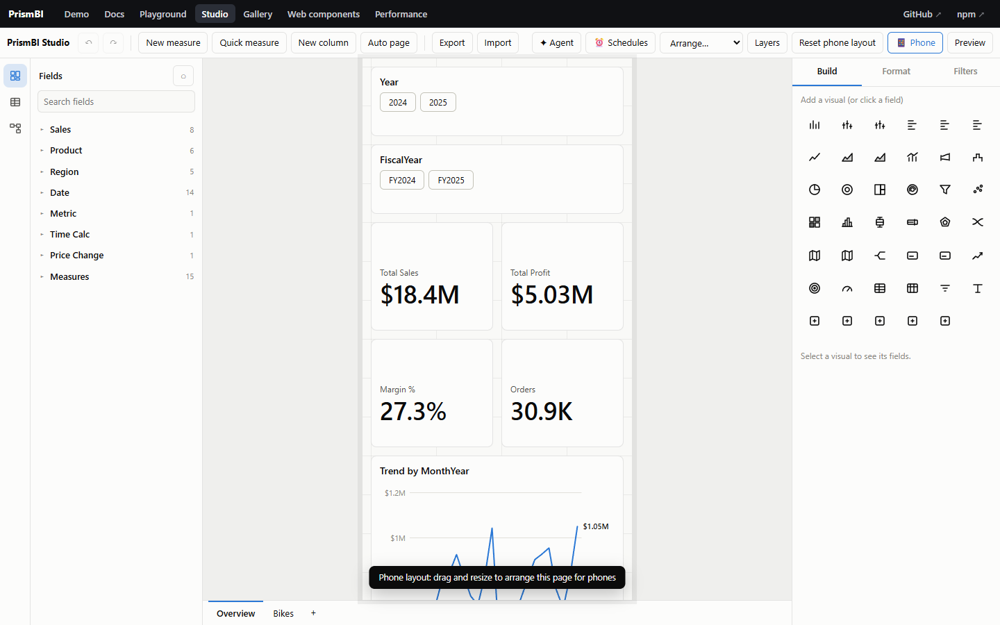

# Studio (report editor)

`@prismbi/prismbi/studio` is a drag-and-drop report editor that works like Power BI Desktop, in the browser. End users build and change reports, and the result is a JSON document you store wherever you like.



```ts
import { Studio } from '@prismbi/prismbi/studio';

const studio = new Studio(document.getElementById('editor')!, {
  model,                          // your DataModel
  storageKey: 'sales-report',     // optional: autosave to localStorage and restore on load
  // document: savedDoc,          // or open a saved document
  // starter: 'blank',            // new documents start from a generated page by default
});

studio.on('change', (doc) => api.saveDraft(doc));   // every undoable change
studio.on('save', (doc) => api.publish(doc));        // Ctrl+S / studio.save()
```

React:

```tsx
import { PrismStudio } from '@prismbi/prismbi/react';
<PrismStudio model={model} storageKey="sales-report" onChange={saveDraft} style={{ height: '100vh' }} />
```

To show the finished report to viewers, pass `doc.report` to `<PrismReport definition={…}>` or `new Report(el, { model, ...doc.report })`.

## What users can do

| Area | Features |
|---|---|
| **Canvas** | Select visuals, drag to move, resize from 8 handles. Magnetic smart alignment snap lines guide placement against neighboring visual edges. Multi-visual lasso marquee drag selection. Everything snaps to the page grid, which is visible while editing. Click empty space to deselect |
| **Keyboard** | Arrows nudge (Shift+arrows resize) · Delete removes · Ctrl+D duplicates · Ctrl+C / Ctrl+V copy and paste · Ctrl+] / Ctrl+[ front and back · Ctrl+Z / Ctrl+Y undo and redo · Ctrl+S saves · Esc deselects |
| **Selection & Layers** | Side pane listing visuals front-to-back with visibility toggles (hide/show), lock protection, and z-order reordering |
| **Quick measures** | Wizard dialog generating parameterized DAX measures for Year-over-Year Growth, Running Total, Rolling 3-Month Average, and Share of Category |
| **Fields pane** | Tables with measures (grouped by display folder), columns and hierarchies, plus search and "show hidden". Drag a field onto the canvas, a visual or a well. Click it to add it to the selected visual, or to create a fitting visual. The ⋯ menu edits or deletes measures and studio-created columns, and offers "New measure: Sum" for numeric columns |
| **Build pane** | Visual type picker: changing type keeps your fields. Field wells per data role: drop, reorder by drag, remove, and change aggregation for columns used as values |
| **Format pane** | Generated from a format schema: general (title, Top N, interaction), size and position, title, legend, data labels, axes (including continuous and log), colors (fixed, per series, gradient, rules), bars, lines, analytics (trend and reference lines), small multiples, tooltip (including report-page tooltips), plus visual-specific sections (card, table, matrix, slicer, map, waterfall …), background, border and header icons. With nothing selected, it shows **page settings** (grid, background, hidden, drill-through fields, tooltip page), the **report name** and the **theme designer** (mode, accent, backgrounds, text, font, radius, 8 data colors) |
| **Filters pane** | Visual, page and report filters (Basic, Advanced, Top N) |
| **Pages** | Add, rename (double-click), duplicate, hide, reorder and delete, from the tab bar and its right-click menu. Tooltip and drill-through pages are labelled |
| **Measures and columns** | Editors with DAX completion, live diagnostics, signature help, a value preview, format presets and display folders. Renaming a measure updates the visuals that use it |
| **Data view** | Browse every table (types, formats, calculated columns) with high-performance virtualized scrolling |
| **Model view** | A relationship diagram with organic hierarchical DAG layout placing fact tables centrally and dimensions by relationship cardinality. Drag tables to arrange them. Drag a column onto another table's column to create a relationship: the side with unique values becomes the one side, otherwise it's many-to-many, and it's inactive when another active path exists. Click a line to switch it active or inactive, change its direction, or delete it |
| **Auto page** | Generates a starter page from the model: slicers, KPI cards, trend, breakdowns and a detail table (`autoReport(model)`) |
| **Preview** | Hides the editing chrome so you can try the report as a viewer would (cross-filtering, drill, tooltips) |
| **Export / Import** | Download or open the document as JSON |

## The document



```ts
interface StudioDocument {
  version: 1;
  report: ReportDefinition;      // pages, visuals, filters, bookmarks (schema-versioned)
  model: StudioModelState;       // measures / columns / relationships added or changed in the studio
  theme?: Record<string, unknown>; // theme overrides
  diagram?: Record<string, { x: number; y: number }>; // model view layout
}
```

Model changes are stored as a diff against the model the studio was opened with. Your code stays the source of truth for tables and base measures, and opening a document replays the user's additions and edits on top. Undo and redo cover report and model edits alike. Moving tables in the diagram is saved but isn't an undo step.

**Versioning.** `report.version` follows `REPORT_SCHEMA_VERSION`. `migrateReport(json)` upgrades older documents, and newer ones are rejected with a clear message. `Report.parse()` and `report.load()` migrate automatically.

## API

| Member | |
|---|---|
| `document` / `load(doc)` / `exportJSON()` / `save()` | Read or open documents. `save()` writes to `storageKey` and emits `save` |
| `undo()` · `redo()` · `canUndo` · `canRedo` · `isDirty` | History |
| `addVisual(type, fields?)` · `addField(ref)` · `assign(visualId, ref, role?, index?)` · `setVisualType(type)` · `select(id)` | Build reports from code (each call is one undo step) |
| `setView('report' \| 'data' \| 'model')` · `setPreview(on)` | Views |
| `editMeasure(name?)` · `editColumn(table?, name?)` | Open the editors |
| `report` · `model` | The underlying `Report` (edit-mode APIs below) and `DataModel` |
| `on('change' \| 'save' \| 'selection', fn)` | Events |

### Report edit-mode APIs (usable without the studio)

`setEditMode(on)` · `selectedVisual` · `visualFormat(id)` · `findFreeSpot(w, h)` · `duplicateVisual(id)` · `arrange(id, 'front' | 'back')` · `updatePage(id, patch)` · `movePage(id, index)` · `duplicatePage(id)` · `pageDefinition(id?)` · `load(definition)`, plus the events `definitionChanged` and `visualSelected`.

### Building blocks

`assignField`, `retargetFields`, `autoVisualFor`, `defaultSize`, `fieldKind`, `autoReport`, `History`, `sectionsFor` / `COMMON_SECTIONS` / `TYPE_SECTIONS` (the format schema) and `ExpressionEditor` are all exported. You can build a custom editor shell or add your own sections to the format schema.

## DAX copilot

`new Studio(el, { model, copilot: daxCopilot(model) })` (from `@prismbi/prismbi/ai`) adds a plain-English box to the measure editor: **✦ Write DAX** fills in the expression, name and format, and **Explain** describes the current expression. Any object with `write(request)` and an optional `explain(expression)` works, so you can plug in your own service. See [AI](ai.md#dax-copilot).


## Phone layouts

Press **📱 Phone** in the top bar to arrange the current page for phones:


- **Canvas:** it narrows to phone width with a 4-column grid.
- **Editing:** dragging and resizing edit the phone layout only; the desktop layout is untouched.
- **Starting point:** the first time, the page's visuals are stacked in reading order, with small cards paired side by side. **Reset phone layout** regenerates that arrangement.

Phone layouts are saved on the page as `mobile` and used automatically below 640 px:

```ts
{ id: 'overview', name: 'Overview', visuals: [/* … */],
  mobile: { columns: 4, visuals: [{ id: 'k-sales', layout: { x: 0, y: 0, w: 2, h: 3 } }, /* … */] } }
```

| API | Does |
|---|---|
| `report.setLayoutMode('auto' \| 'desktop' \| 'mobile')` | choose the layout; `'auto'` switches at `mobileBreakpoint` (default 640) |
| `report.autoMobileLayout(page?)` | (re)generate a page's phone layout |
| `report.setMobileVisibility(id, visible)` | hide a visual on phones, or bring it back at the bottom |
| `report.setMobileLayout(id, layout)` | move or resize a visual in the phone layout |
| `report.isMobileLayout` | whether the phone layout is showing |

Visuals not listed in `mobile.visuals` are hidden on phones. Pages without a phone layout keep the automatic behaviour: below 640 px every visual takes the full width, in order.

## Selecting and arranging several visuals

- **Selecting several:** Ctrl-, Shift- or Cmd-click visuals on the canvas or in **Layers**. Ctrl+A selects every visual on the page.
- **Moving together:** dragging any selected visual moves the whole selection, kept on the grid, and undoes as one step.
- **Arrange menu:**
  - align left, center, right, top, middle or bottom (two or more selected)
  - distribute horizontally or vertically (three or more)
  - group (Ctrl+G) and ungroup (Ctrl+Shift+G); grouped visuals select and move together and are marked ⧉ in Layers
  - bring to front, bring forward, send backward, send to back
- **Layers:** lists the page front to back. Click to select, use the arrows to reorder.

In code: `report.selectedVisuals`, `selectVisuals(ids)`, `toggleVisualSelection(id)`, `alignVisuals(how, ids?)`, `distributeVisuals(axis, ids?)`, `groupVisuals(ids?)`, `ungroupVisuals(ids?)`, `arrange(id, 'front' | 'forward' | 'backward' | 'back')` and `commitLayouts(updates)`. All of them work on whichever layout is showing, desktop or phone.
