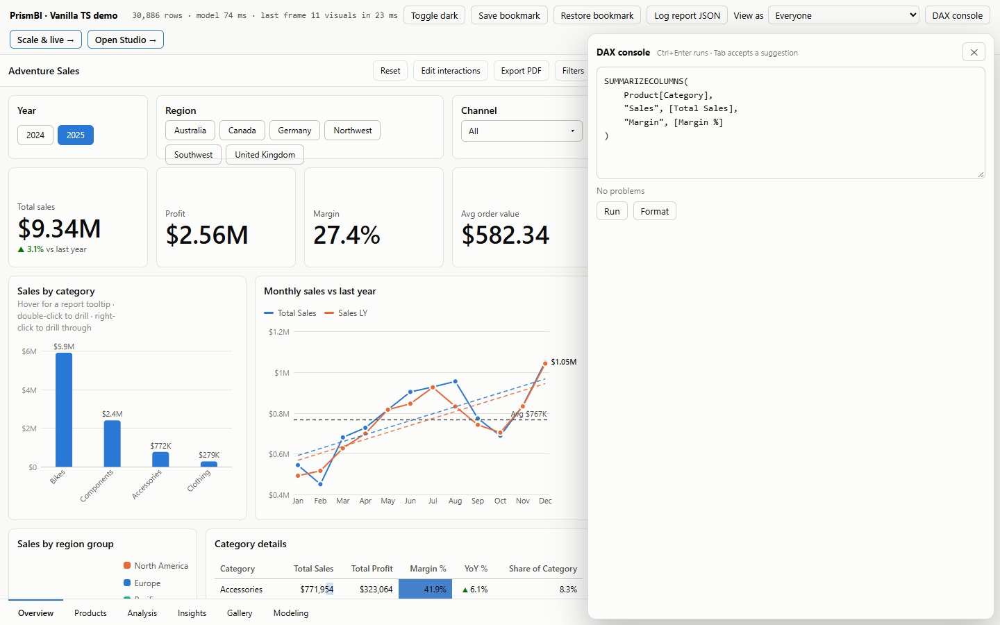

# DAX tooling

These are building blocks for editors, consoles and documentation. They're tree-shaken out of apps that don't import them.



## Language service

```ts
import { DaxLanguageService } from '@prismbi/prismbi';

const ls = new DaxLanguageService(model);

ls.complete('SUM(Sales[Am', 12);   // [{ label: 'Amount', kind: 'column', insertText: 'Amount]', from: 10, to: 12, … }]
ls.complete('[Tot', 4);            // measures
ls.complete('CALCU', 5);           // functions (CALCULATE first), tables, keywords, VAR names
ls.hover('[Total Sales]', 3);      // { title: '[Total Sales]', detail: 'Measure · $#,0', documentation: 'SUM(Sales[Amount])' }
ls.signatureHelp('DIVIDE(1, ', 10); // { name: 'DIVIDE', signature: 'DIVIDE(<numerator>, <denominator>, [<alternate>])', activeParameter: 1 }
ls.diagnose('SUM(Sales[Nope])');   // [{ from: 9, to: 15, severity: 'error', message: "Column [Nope] not found in table 'Sales'" }]
ls.format('calculate(sum(Sales[Amount]),Products[Color]="Red")');
```

All positions are character offsets, so you can map them to CodeMirror, Monaco or a plain `<textarea>`. The demo's **DAX console** (`examples/console.ts`) is a complete textarea-based example in about 150 lines.

Diagnostics cover:
- syntax errors, with their position
- unknown functions, tables, columns, measures and variables

## Formatter

```ts
import { formatDax } from '@prismbi/prismbi';
formatDax('VAR a=1 VAR b=2 RETURN a+b');
// VAR a = 1
// VAR b = 2
// RETURN
//     a + b
formatDax(longExpression, { indent: '  ', maxLine: 100 });
```

The formatter adds parentheses only where precedence needs them, keeps spacing consistent, and breaks calls that run past `maxLine` onto one argument per line.

## Dependency explanation

```ts
import { explainDax } from '@prismbi/prismbi';
explainDax(model, '[Margin %]');
// { formatted, functions: ['DIVIDE', 'SUM'], measures: ['Total Sales', 'Total Cost', 'Profit', 'Margin %'],
//   columns: ['Sales[Amount]', 'Sales[Cost]'], tables: ['Sales'] }
```

Use it for lineage views, impact analysis ("what breaks if I rename this column?") or documentation.

## Function catalog

`DAX_FUNCTIONS` lists every supported function with its signature, description and category, and `DAX_KEYWORDS` lists the bare keywords (intervals, sort orders, directions, types). A test checks that every catalogued function is implemented.

## Lineage, impact and safe renames

```ts
import { lineage, impactOf, renameModelField } from '@prismbi/prismbi';

const graph = lineage(model, report.toJSON());          // nodes (tables, columns, measures, visuals) and "uses" edges
const impact = impactOf(model, { kind: 'column', table: 'Sales', name: 'Amount' }, report.toJSON());
// { measures: ['Total Sales', 'Margin %', …], columns: ['Sales[Profit]'], visuals: [{ pageName, visualId, title }, …] }

const { report: updated } = renameModelField(model, { kind: 'measure', name: 'Total Sales' }, 'Revenue', report.toJSON());
report.load(updated!);
```

- **Impact:** `impactOf` follows dependencies transitively, through measures and calculated columns, up to the visuals that would break.
- **Renaming:** `renameModelField` renames a measure or column and rewrites the references in other measures, calculated columns, and the report's visual fields and filters.
  - Rewriting works on DAX tokens, so a string like `"[Total Sales]"` is never touched.
  - `Table[Name]` keeps meaning a column when that table has one.
  - `model.renameColumn` renames just the column; relationships follow.
- **In the Studio:** renaming a measure or calculated column in its editor applies all of this automatically. Deleting a measure lists everything that uses it first.
