# Visuals reference

Every visual is a `VisualSpec`:

```ts
{
  id?: string;                      // stable id (auto-generated otherwise)
  type: 'clusteredColumn';          // see the table below
  title?: string;
  layout?: { x, y, w, h, z? };      // grid units (page default: 12 columns × 44px rows)
  fields?: { [role]: FieldSpec | FieldSpec[] };
  filters?: FilterSpec[];           // visual-level filters
  format?: { ...format pane };      // see "Common format options" below
  sort?: { field: 'Total Sales', direction: 'desc' };
  top?: number;                     // keep first N groups after sorting
  interaction?: 'filter' | 'highlight' | 'none';   // how it reacts to other visuals
  interactionsFrom?: { [sourceVisualId]: 'filter' | 'highlight' | 'none' };
  drill?: { level, path, skip? };   // persisted drill state
  hidden?: boolean; className?: string; style?: string;
}
```

A `FieldSpec` is one of:
- a measure name, e.g. `'Total Sales'`
- a column ref, e.g. `'Products[Category]'`. In a measure role, this gets an implicit aggregation.
- `{ field: 'Sales[Qty]', aggregation: 'avg', name: 'Avg qty', format: '#,0.0' }`
- `{ expression: 'SUM(Sales[Amount]) * 1.1', name: 'Forecast', format: '$#,0' }`

## Gallery

Every built-in visual with the demo data (light theme). The same images back the visual regression tests.

| | | |
|---|---|---|
| 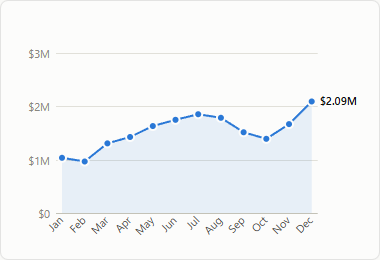 `area` | 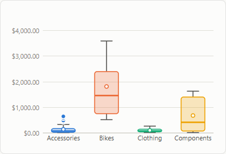 `boxPlot` | 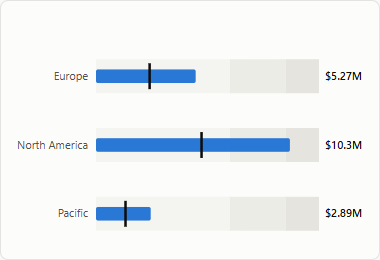 `bullet` |
| 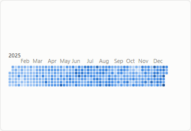 `calendar` | 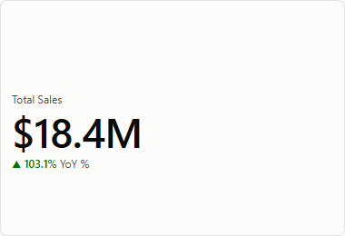 `card` | 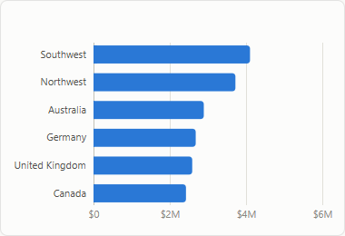 `clusteredBar` |
| 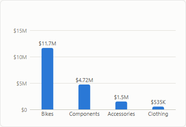 `clusteredColumn` | 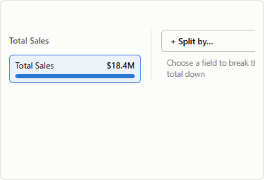 `decompositionTree` | 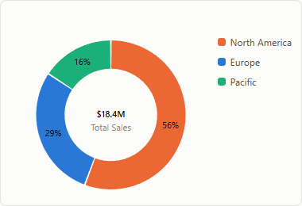 `donut` |
| 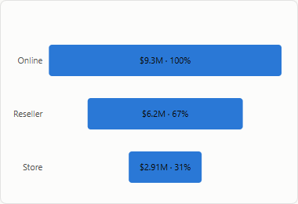 `funnel` | 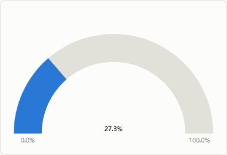 `gauge` | 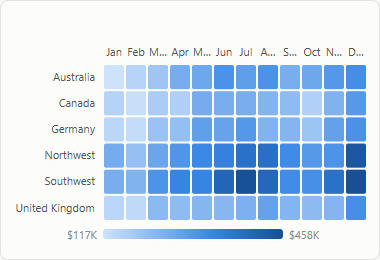 `heatmap` |
| 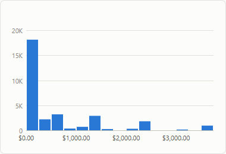 `histogram` | 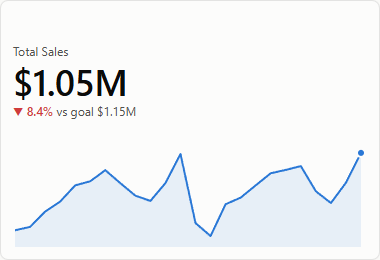 `kpi` | 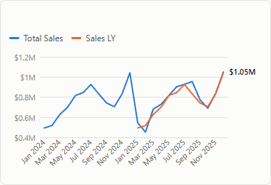 `line` |
| 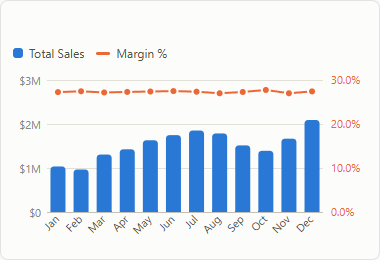 `lineClusteredColumn` | 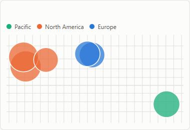 `map` | 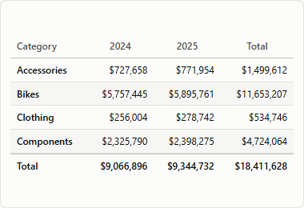 `matrix` |
| 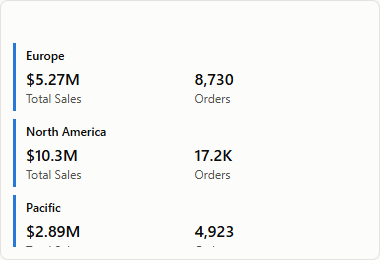 `multiRowCard` | 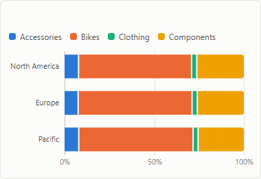 `percentStackedBar` | 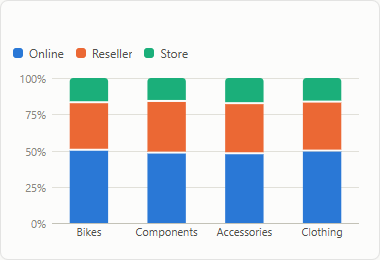 `percentStackedColumn` |
| 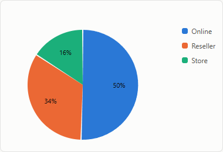 `pie` | 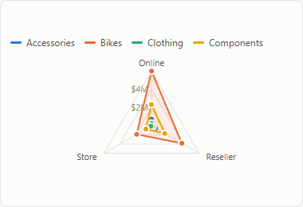 `radar` | 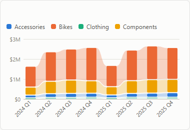 `ribbon` |
| 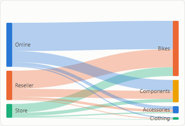 `sankey` | 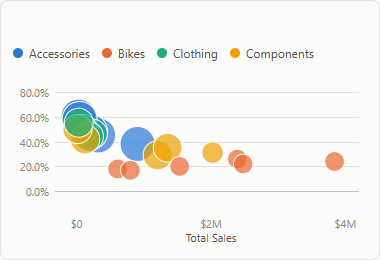 `scatter` | 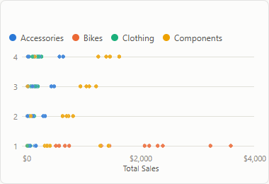 `scatter-webgl` |
| 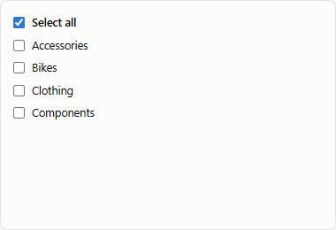 `slicer-list` | 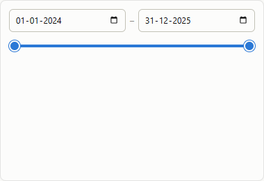 `slicer-range` | 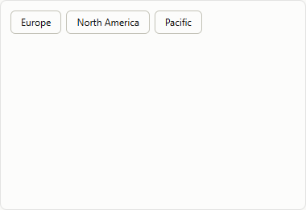 `slicer-tiles` |
| 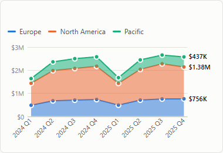 `stackedArea` | 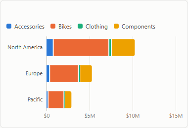 `stackedBar` | 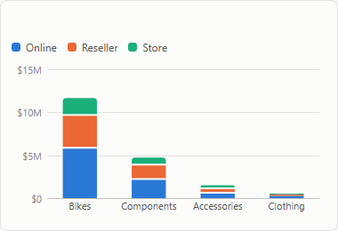 `stackedColumn` |
| 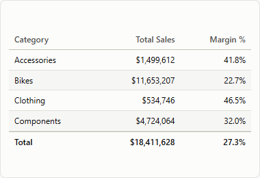 `table` | 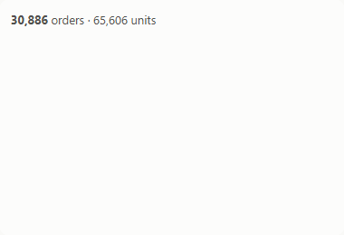 `text` | 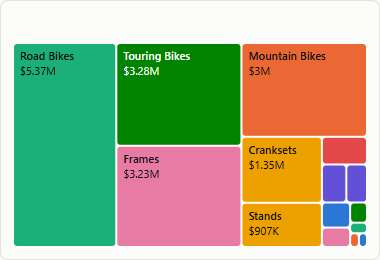 `treemap` |
| 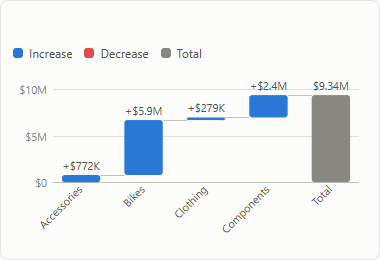 `waterfall` | 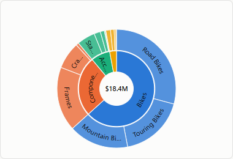 `sunburst` | 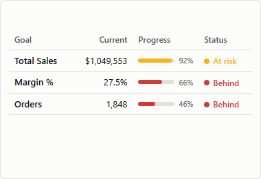 `scorecard` |

## Catalogue

| Type (aliases) | Roles | Notes |
|---|---|---|
| `clusteredColumn` (`column`) | `category`* (drillable, multiple) · `legend` · `values`* (multiple) · `smallMultiples` | Sorted by first value, descending, unless the category is a number, a date or has sort-by |
| `stackedColumn`, `percentStackedColumn` | same | 2 px gaps between segments. Categories sorted by total |
| `clusteredBar` (`bar`), `stackedBar`, `percentStackedBar` | same | Horizontal versions |
| `line` | `category`* (drillable) · `legend` · `values`* · `smallMultiples` | Crosshair tooltip, end labels (four or fewer series), markers (16 or fewer points), cross-highlight |
| `area`, `stackedArea` | same | 10% area wash. Stacked area sums series |
| `lineClusteredColumn` (`combo`) | `category`* · `legend` (columns) · `values` (columns) · `lineValues` | **One shared value axis** by design. A second y-axis is a known chart anti-pattern |
| `waterfall` | `category`* (drillable) · `values`* | Running total with connectors, increase / decrease / total colours, optional total bar |
| `pie`, `donut` | `legend`* (drillable) · `values`* | Folds slices past the palette into "Other". Donut shows a centre total |
| `treemap` | `category`* (drillable) · `values`* | Squarified layout |
| `scorecard` (`goals`) | `values`* (goals, multiple) · `targets` (paired with values in order) · `trend` | Current value (the latest trend point, else the total), target, progress, status and sparkline per goal; settings in `format.scorecard.goals` |
| `sunburst` | `category`* (multiple: one ring per level, first innermost) · `values`* | Each level is a real measure evaluation (ratios stay right); children split their parent's angle by value; centre total; click any ring to select that level |
| `funnel` | `category`* · `values`* | Shows % of first stage |
| `scatter` (`bubble`) | `details`* · `legend` · `x`* · `y`* · `size` | Bubble area ∝ size. Cross-highlight, trend line |
| `heatmap` | `rows`* · `columns`* · `values`* | Sequential single-hue ramp, gradient legend, cell labels when they fit |
| `decompositionTree` (`decomp`) | `values`* · `explainBy`* (multiple) | Split a total level by level, click nodes to narrow down, automatic "High value / Low value" splits. Cross-filters the page |
| `histogram` | `values`* (numeric column) · `weight` (optional measure) | Bins by Sturges' rule or `format.histogram.bins` / `binWidth` |
| `boxPlot` | `category` · `values`* (numeric column) | Quartiles, 1.5 × IQR whiskers, outliers, mean marker |
| `bullet` | `category` · `value`* · `target` · `maximum` | Value bar over qualitative bands with a target tick |
| `radar` | `category`* (spokes, 3 or more) · `legend` · `values`* | One polygon per series on a shared radial scale |
| `sankey` | `source`* · `target`* · `values`* | Multi-stage flows (a target that is also a source becomes a middle column) |
| `ribbon` | `category`* · `legend`* · `values`* | Stacked by rank in each column, with ribbons showing rank changes |
| `map` (`bubbleMap`) | `location`* · `legend` · `latitude` · `longitude` · `size` | Columns are averaged per location. Without latitude and longitude, bubbles sit at the centre of their region (`format.map.boundaries` or `geojson`). Optional clustering |
| `filledMap` (`choropleth`) | `location`* · `values`* | Built-in `boundaries` (`@prismbi/prismbi/geo`) or your `geojson`. Gradient or classed legend |
| `card` | `value`* · `delta` | Auto-sized callout value, signed delta with good/bad colour |
| `multiRowCard` | `category` · `values`* | One card per group |
| `kpi` | `trend` · `value`* · `target` | Headline is the last trend point. Shows % vs goal and a sparkline |
| `gauge` | `value`* · `min` · `max` · `target` | 180° arc |
| `table` | `columns`* (columns and measures mixed) | Click a header to sort. Totals, conditional formatting, incremental rendering |
| `matrix` | `rows` (hierarchy) · `columns` · `values`* | Expand/collapse, column pivot, real subtotals and totals |
| `slicer` | `field`* (several fields give a hierarchy tree) | list · dropdown · tiles · between · relative date · tree. Sync groups across pages |
| `text` (`textbox`) | `values` (optional) | Mini-markdown with `{{Measure name}}` placeholders |

`*` marks a required role.

**Small multiples:** put a field in `smallMultiples` (column, bar, line, area, scatter and bullet charts) to get one panel per member, with a shared value axis and a single legend. Configure it with `format.smallMultiples: { columns?, sharedAxis: true, minWidth: 160, minHeight: 110 }`.

## Common format options

All of these are optional. Values merge as: base defaults ← visual defaults ← `theme.visualStyles['*']` ← `theme.visualStyles[type]` ← `spec.format`.

```ts
format: {
  title:      { show: true, text, subtitle, fontSize, color, align: 'left'|'center'|'right', bold: true },
  background: { show: true, color, transparency: 0 },          // 0–100
  border:     { show: true, color, width: 1, radius },
  shadow:     { show: false },
  padding:    12,
  header:     { show: true, focusMode: true, exportData: true, showAsTable: true, drill: true },
  tooltip:    { show: true, page: 'tooltip-page-id' },  // report tooltip page
  legend:     { show: 'auto' | true | false, position: 'top'|'bottom'|'left'|'right', fontSize },
  dataLabels: { show: false, format, displayUnits: 'auto', decimals, fontSize, color, position: 'auto' },
  categoryAxis: { show: true, maxLabelWidth: 120, labelAngle: 'auto'|0|45|90,
                  type: 'auto'|'categorical'|'continuous',   // auto = continuous for date/number fields on line & area
                  scale: 'linear'|'log' },                   // scatter x-axis
  valueAxis:  { show: true, displayUnits: 'auto', decimals, min, max, gridlines: true, tickCount: 5, scale: 'linear'|'log' },
  colors:     { default, palette: [...], series: { 'Total Sales': '#...' }, categories: { 'Bikes': '#...' },
                rules: [{ op: '<', value: 0, color: '#d03b3b' }],      // single-series charts, first match wins
                gradient: { min: '#cde2fb', max: '#0d366b' } },        // single-series charts, by value
  analytics:  { referenceLines: [{ type: 'average' | 'median' | 'min' | 'max' | 'percentile' | 'constant', value?, percentile?, label?: 'Goal {value}' | false, color?, dash? }],
                trendLine: false | true | { color } },
  bars:       { maxThickness: 24, radius: 4, gap: 2, categoryGap: 0.35 },
  lines:      { width: 2, markers: 'auto', smooth: false, area: false, areaOpacity: 0.1, endLabels: true, collisionAvoidance: true },
  animation:  { enabled: true, duration: 280 },
}
```

`legend.show: 'auto'` shows a legend when there are two or more series, and hides it for one series because the title already says what is plotted.

`animation` controls motion. On the first render, charts grow in. When the data changes (a filter, a slicer or a selection), each data point moves from where it was to its new place, matched by its identity (category, series). Points that are new fade in. Lines and areas morph when their shape allows it. `duration` is in milliseconds. Users with `prefers-reduced-motion` get no animation. Exports always capture the final state.

### Visual-specific sections

```ts
// card
format: { card: { labelPosition: 'top'|'bottom', showLabel: true, align: 'left'|'center', valueFontSize, upIsGood: true, deltaLabel: 'vs LY' } }

// kpi
format: { kpi: { upIsGood: true } }

// pie / donut
format: { pie: { maxSlices: 8 }, donut: { innerRadius: 0.62, centerLabel: true } }

// table
format: { table: {
  totals: true, rowBanding: true, wrap: false, density: 'compact'|'normal'|'comfortable', pageSize: 200,
  columnWidths: { 'Total Sales': 140 },
  conditional: {
    'Total Sales': { dataBars: true },                         // or { color, negativeColor }
    'Margin %':    { background: true },                       // or { min, mid, max } colours
    'YoY %':       { icons: true },                            // ▲ ▼ ● by sign
    'Profit':      { rules: [{ op: '<', value: 0, color: '#d03b3b' }, { op: 'between', value: 0, value2: 1000, background: '#fff4d6' }] },
  },
} }

// matrix
format: { matrix: {
  expandAll: false, columnTotals: true,
  stepped: false,                      // false = dedicated column per row hierarchy level (Power BI tabular style)
  sparklines: { 'Total Sales': { type: 'line', trend: 'Date[MonthYear]' } }, // embedded SVG trend sparklines / mini-bars
  virtualize: undefined,               // auto above 500 visible rows
  conditional: { /* as table */ },
} }

// slicer
format: { slicer: {
  style: 'list' | 'dropdown' | 'tiles' | 'between' | 'relative' | 'slider',   // dates default to 'between'; 'slider' = one value (what-if)
  single: false, search: true, selectAll: true, orientation: 'horizontal', placeholder: 'All',
  relative: { anchor: 'last'|'next'|'this', n: 30, unit: 'days'|'weeks'|'months'|'years', includeToday: true },
} }

// text
format: { text: { content: '# Heading\n**{{Total Sales}}** this period. [Docs](https://example.com)' } }

// waterfall
format: { waterfall: { showTotal: true, totalLabel: 'Total', increaseColor, decreaseColor, totalColor } }

// decomposition tree
format: { decomposition: { maxNodes: 10, aiSplits: true, columnWidth: 190 } }

// histogram
format: { histogram: { bins: 20, binWidth: 50 } }

// bullet
format: { bullet: { bands: [0.6, 0.85, 1], sharedScale: true } }

// maps (bubble and filled)
format: { map: {
  boundaries: 'world',                     // or 'usStates': built-in outlines, after import '@prismbi/prismbi/geo'
  geojson: featureCollection,              // or your own outlines
  featureKey: 'name',                      // property (or list) matched against the location field
  legend: 'classes', classes: 5,           // filled maps: quantile classes instead of a gradient
  cluster: { radius: 40 },                 // bubble maps: group nearby bubbles; click or Enter zooms in
  tiles: 'https://tiles.example.com/{z}/{x}/{y}.png', attribution: '© provider',   // optional raster basemap
  maxRadius: 28, zoom: true, graticule: true,
} }

// scatter: force a renderer (auto: SVG, canvas above 3,000 points, WebGL above 50,000)
format: { scatter: { renderer: 'auto' | 'svg' | 'canvas' | 'webgl' } }

// heatmap and calendar: canvas above 3,000 cells (auto), with the same tooltips, selection and drill; SVG without a 2D canvas
format: { heatmap: { renderer: 'auto' | 'svg' | 'canvas' } }
format: { calendar: { renderer: 'auto' | 'svg' | 'canvas' } }

// slicer sync group (any style)
format: { slicer: { syncGroup: 'year' } }
```

## Header actions

Hovering or focusing a visual shows its header icons:
- **⤢ Focus mode** fills the page. Esc exits.
- **▦ Show as table** displays the query result as a table.
- **⇩ Export** opens a menu: data (CSV or Excel), image (PNG at 2×), image (SVG), and **Copy image** (writes PNG directly to system clipboard). The same is available in code as `report.visual(id).exportCsv()`, `.exportXlsx()`, `.exportImage('png' | 'svg')`, `.copyImage()` and `.toSvg()`.
- **↑ Drill up**, **⇊ Go to next level** and **⤓ Expand all down one level** appear when a drillable role has several fields.
- **⌫ Clear selections** appears on slicers.

Each of these can be turned off through `format.header`.

## Accessibility

Marks are focusable (Tab), and Enter or Space selects one. Tooltips also show on focus. Each chart has an `aria-label` from its title, and tables use real `<table>` markup with `aria-sort`. Animations respect `prefers-reduced-motion`.

## Forecast

Line and area charts with a date or number axis can extend each series (up to three) with a forecast:

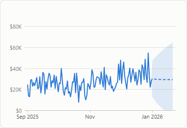

```ts
{ type: 'line', fields: { category: 'Date[Date]', values: 'Total Sales' },
  format: { analytics: { forecast: { periods: 30, confidence: 0.95, seasonality: 'auto' } } } }
```

- **Model:** damped additive Holt-Winters. Its parameters are chosen by one-step-ahead error, and the season length is detected by autocorrelation, or given as a number, or turned off with `'none'`.
- **Display:** the forecast is a dashed line inside a shaded prediction interval that widens with the horizon.
- **Non-negative series:** a series that has never been negative (sales, counts) is never forecast below zero.
- **Dates:** future dates follow the calendar for monthly, quarterly and yearly data.

## Error bars

Clustered column and bar charts with a single series accept two optional measure roles, **Error bars: lower** (`errorLower`) and **Error bars: upper** (`errorUpper`):

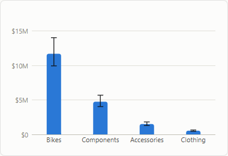

```ts
{ type: 'clusteredColumn', fields: { category: 'Product[Category]', values: 'Avg Price', errorLower: 'Price P10', errorUpper: 'Price P90' } }
```

- **Drawing:** each bar gets a whisker with caps between the two bounds. With only one bound, the whisker runs from the bar's value to that bound.
- **Axis:** the value axis grows to include the bounds.
- **Tooltip:** shows the range.

## Maps and built-in boundaries

| Filled map (classes) | Bubbles at country centres | Clusters |
|---|---|---|
| 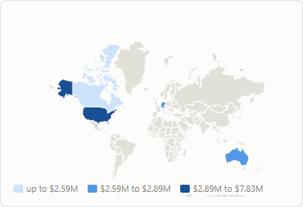 | 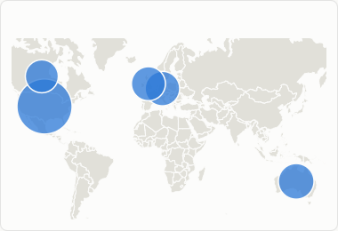 | 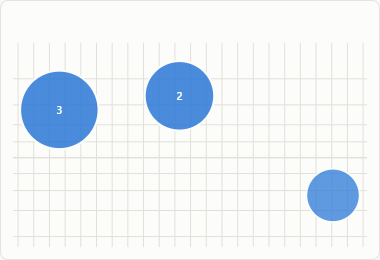 |

`@prismbi/prismbi/geo` adds world countries and US states (Natural Earth 1:110m, public domain) as an optional entry. The data is about 60 KB gzipped, and you only pay for it when you import it:

```ts
import '@prismbi/prismbi/geo';

{ type: 'filledMap', fields: { location: 'Region[Country]', values: 'Total Sales' }, format: { map: { boundaries: 'world', legend: 'classes' } } }
{ type: 'map', fields: { location: 'Region[Country]', size: 'Total Sales' }, format: { map: { boundaries: 'world' } } }   // bubbles at country centres
{ type: 'filledMap', fields: { location: 'Store[State]', values: 'Orders' }, format: { map: { boundaries: 'usStates' } } }
```

- **Matching:**
  - Countries match on name, long name, or ISO alpha-2 or alpha-3 code (`France`, `FR`, `FRA`). Common variants like `USA`, `UK` and `Czech Republic` work too.
  - States match on name, postal code or ISO 3166-2 code (`Texas`, `TX`, `US-TX`).
  - Locations that don't match are left out.
- **Framing:** filled maps with built-in boundaries zoom to the regions that have data.
- **Your own regions:** `registerGeoJson(name, geojson, keys?)` (or `registerBoundaries`) registers arbitrary GeoJSON feature collections (e.g. custom sales territories, school districts, postal zip codes) under a named identifier. Helper functions `hasBoundaries`, `listBoundaries`, `removeBoundaries`, `worldCountries`, `usStates`, `featureCentroid`, `clusterPoints` and `quantileBreaks` are exported from `@prismbi/prismbi/geo`.
- **Clustering:** clusters are recomputed as you zoom. Each cluster shows its count, and its tooltip lists the total and some of its locations. Click a cluster, or press Enter on it, to zoom in.

## Calendar heatmap

`type: 'calendar'` draws one square per day, with weeks as columns and weekdays as rows, and one band per year. It's coloured on the theme's sequential ramp, or by `format.colors.gradient` and rules.


```ts
{ type: 'calendar', fields: { date: 'Date[Date]', values: 'Total Sales' } }
```

- **Labels:** month names collapse to initials when space is tight, and weekday labels appear when the cells are large enough.
- **Interaction:** clicking a day cross-filters the page like any data point.

## Sunburst

`type: 'sunburst'` shows a hierarchy as rings, the first level innermost. Each ring is evaluated at its own level, like a matrix's subtotals, so ratios such as a margin stay right; children split their parent's angle by value. Labels follow the arc and turn along the radius on narrow slices. The total sits in the middle, and clicking any ring selects that level (a category, or a category and subcategory).


```js playground
import { createVisual } from '@prismbi/prismbi';

return createVisual(el, {
  model,
  type: 'sunburst',
  title: 'Sales by category and subcategory',
  fields: { category: ['Product[Category]', 'Product[Subcategory]'], values: 'Total Sales' },
});
```

## Scorecard (goals)

`type: 'scorecard'` tracks goals: each measure in **Goals** gets its current value, target, progress, a status and a trend sparkline. With a **Trend axis**, the current value is the latest point that has one (like a goal check-in); without it, the total.


- **Targets:** a measure in **Targets**, paired with the goals in order, or a fixed `target` per goal.
- **Status:** progress = value ÷ target (target ÷ value for `direction: 'down'`, such as costs). At least 100% is **On track**, from `atRisk` (default 90%) **At risk**, below that **Behind**. `goalStatus(value, target, goal)` applies the same rules, for alerts or exports.
- **Columns:** owner and due date appear when a goal has them; narrow tiles drop due, owner, trend, target and then progress, keeping the goal, its value and status.

```js playground
import { createVisual } from '@prismbi/prismbi';

return createVisual(el, {
  model,
  type: 'scorecard',
  fields: { values: ['Total Sales', 'Margin %'], targets: ['Sales Target'], trend: 'Date[MonthYear]' },
  filters: [{ target: 'Date[Year]', op: 'eq', value: 2025 }],
  format: { scorecard: { goals: { 'Margin %': { target: 0.42, owner: 'Finance', due: '2025-12-31' } } } },
});
```

## Axis zoom

`format.categoryAxis.zoom: true` adds a range slider under line and area charts. Dragging its thumbs narrows the visible part of the axis, and **Reset** shows everything again. The zoom is view state kept per visual, so it doesn't change filters or re-query.

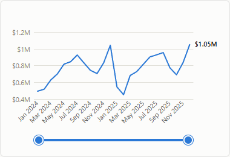

## Try it

```js playground
import { createVisual } from '@prismbi/prismbi';

return createVisual(el, {
  model,
  type: 'waterfall',
  title: 'Change vs last year by category',
  fields: { category: 'Product[Category]', values: 'Sales Change' },
  filters: [{ target: 'Date[Year]', op: 'eq', value: 2025 }],
});
```

On the docs site (`npm run docs`), **▶ Run in playground** opens it in an editor next to its output.
